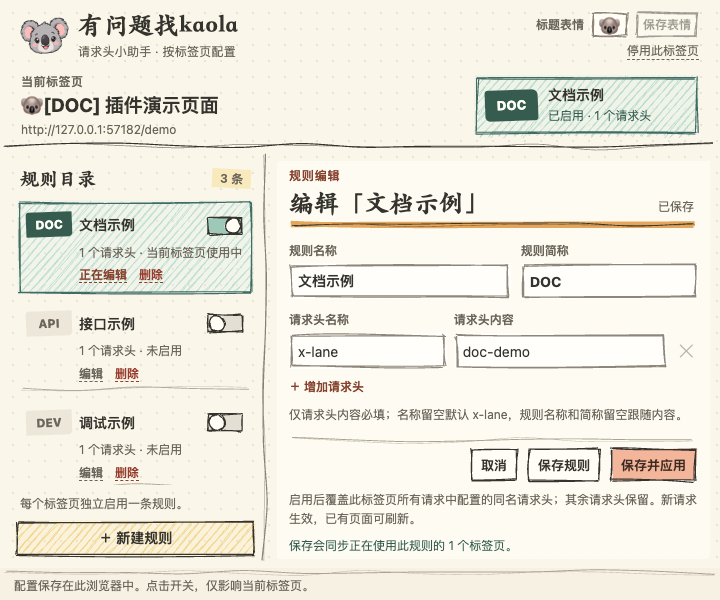

<p align="center">
  
</p>

<h1 align="center">有问题找kaola</h1>

<p align="center">同一个域名，多个 Tab，各用各的请求头。</p>
<p align="center">v1.0.1 · Chrome 110 及以上 · 本地浏览器扩展</p>

<p align="center">
  <a href="https://github.com/JackYuanzzz/kaola-header-switcher/releases/latest"><strong>下载已打包的插件</strong></a>
  · <a href="#安装">安装</a>
  · <a href="#使用">使用</a>
  · <a href="#常见问题">常见问题</a>
  · <a href="#开发">开发</a>
</p>

为不同测试环境保存请求头，在浏览器右上角直接选择当前标签页使用哪条规则。请求头配置、规则切换和标题表情，都在一个手绘风弹窗里完成。

<p align="center">
  
</p>

截图来自实际运行的扩展，使用演示配置，不含真实业务域名、页面标题、lane 或凭据。

## 安装

**日常使用不需要 Node.js，也不需要自己构建。**

1. 打开 [GitHub Releases 下载页](https://github.com/JackYuanzzz/kaola-header-switcher/releases/latest)，在 **Assets** 中下载 [lane-header-switcher-1.0.1.zip](https://github.com/JackYuanzzz/kaola-header-switcher/releases/download/v1.0.1/lane-header-switcher-1.0.1.zip)。不要选择 GitHub 自动生成的 `Source code`，它是源码，不是可安装的插件。
2. 将 ZIP 解压到一个固定目录，安装后保留该目录，不要放在会自动清理的位置。
3. 在 Chrome 地址栏输入 `chrome://extensions`，打开右上角「开发者模式」。
4. 点击「加载已解压的扩展程序」，选择**直接包含 `manifest.json` 的目录**，不是 ZIP 文件，也不是它的父目录。
5. 打开工具栏的扩展菜单，将「有问题找kaola」固定到工具栏。

安装包已经包含运行所需文件。Edge 等 Chromium 浏览器可尝试同样的加载方式；本项目的自动化验收使用 Chromium。

## 使用

### 先配置一个标签页

1. 打开需要联调的普通网页，点击工具栏上的考拉图标，再点「新建规则」。
2. 在「请求头内容」填写测试环境值，例如演示值 `doc-demo`。其他字段可以先留空。
3. 点击「保存并应用」。请求头名称会默认为 `x-lane`，当前 Tab 的后续请求开始使用这条规则。
4. 需要让当前页面重新请求数据时，手动刷新页面。

再打开同一个网址，在第二个 Tab 选择另一条规则，即可同时调试两个环境。一个 Tab 同时启用一条规则，切换开关只影响当前 Tab。

### 字段怎么填

| 字段 | 是否必填 | 留空时的行为 |
| --- | --- | --- |
| 请求头内容 | **每行必填** | 空值或纯空白无法保存 |
| 请求头名称 | 选填 | 使用 `x-lane` |
| 规则名称 | 选填 | 显示第一条非空请求头内容 |
| 规则简称 | 选填，长度不限 | 显示第一条非空请求头内容 |

点击「增加请求头」可配置多个字段，名称不区分大小写，不能重复。请求头内容原样保存；当前校验不接受换行、中文等非 Latin-1 字符。自动显示的名称会合并多余空白，但不会改写请求头内容；以后修改内容，留空的名称和简称会跟随更新。

**内容是密钥时，请显式填写不含敏感信息的名称和简称。** 否则自动命名会把请求头内容显示到规则目录、标签页标题或工具栏提示中。

### 保存、切换与删除

- 「保存规则」保存配置，并同步所有正在使用这条规则的 Tab；新建规则仅保存时不会自动启用。
- 「保存并应用」额外将规则绑定到当前 Tab。停用后，后续请求恢复网页自身提供的请求头。
- 目录里每条规则旁都能直接「删除」，二次确认后才执行，并解除所有使用它的 Tab 绑定。
- 删除其他规则会保留编辑区的未保存内容；删除正在编辑的规则时，会提示同时丢弃它的未保存修改。

**规则内容共享，启用状态按 Tab 独立。** 如果两个 Tab 需要不同的请求头内容，请创建两条规则。

### 看标题就知道当前环境

启用规则后，允许注入的网页标题显示为 `🐨[完整简称] 原标题`。顶部「标题表情」可为当前 Tab 单独设置一个表情，例如 `🦊` 或 `👩🏽‍💻`；点「保存表情」生效，留空保存恢复 `🐨`。

即使使用同一条规则，两个 Tab 也能设置不同表情。未启用规则时可先保存表情，停用后仍保留本会话的选择；保存表情不影响规则草稿。工具栏角标始终只取简称的前 **4 个字素**，不会截断组合 emoji，完整简称仍用于网页标题和悬停提示。停用后恢复原标题。

### 哪些设置会保留

| 操作 | Tab 规则绑定与标题表情 |
| --- | --- |
| 刷新、同一 Tab 内导航、扩展后台休眠 | 保留 |
| 停用当前 Tab 的规则 | 解除绑定，保留该 Tab 的本会话表情 |
| 关闭 Tab | 清理该 Tab 的绑定与表情 |
| 新建、复制或关闭后重新打开 Tab | 默认不启用规则，表情为 `🐨` |
| 浏览器重启，或扩展禁用、重新加载、更新 | 会话状态重置，需要重新选择规则与表情 |

规则列表单独保存在本地，正常重新加载或更新同一扩展时保留。卸载扩展会清除本地规则，升级时不要先卸载。[Chrome Storage 说明](https://developer.chrome.com/docs/extensions/reference/api/storage)

## 使用范围与数据

规则覆盖**当前 Tab 可关联的所有请求域名**，包括第三方地址；会设置你配置的字段，同名字段被覆盖，其余请求头保留。范围包括主页面、子框架、跨域接口、脚本、图片、样式、字体和 WebSocket 握手等。

这意味着配置的请求头也可能发送给页面加载的第三方服务。适合用于测试 lane；不要在这种全域规则中填写只应发送给某一个站点的密钥。

- 按 Tab 改请求头**不隔离 Cookie、站点缓存或登录状态**，这些仍由同一浏览器 Profile 共享。
- Chrome 内置页面、扩展页面和 Chrome Web Store 不能启用。没有关联 Tab 的后台请求也无法按 Tab 分流。
- 规则作用于之后发出的请求，不会重发已有请求、改变已建立的连接或重写缓存内容。Service Worker 自行生成或从 CacheStorage 返回的响应可能不经过网络栈；HTTP 缓存并非一概绕过规则。具体边界见 [Chrome DNR 文档](https://developer.chrome.com/docs/extensions/reference/api/declarativeNetRequest)。
- 规则存于 `storage.local`；绑定、表情和恢复日志存于 `storage.session`。本项目不使用云同步，规则未加密。请求头内容仅供扩展自己的可信页面读取，内容脚本只接收所属 Tab 的显示简称和表情。
- 扩展无远程脚本、CDN 依赖或分析上报，不代理或上传响应内容；**按规则发送请求头是它的核心功能**，本地保存不代表请求头值不会传给目标服务器。

## 常见问题

### 已经启用，为什么看起来没变化？

先确认当前 Tab 的开关已启用，再刷新页面，在浏览器开发者工具的 Network 面板查看**新请求**。已完成的请求不会重发；受限页面、无 Tab 的后台请求和部分 Service Worker 缓存响应不在适用范围内。若同时使用其他改请求头扩展，结果还可能受到 [Chrome 规则优先级](https://developer.chrome.com/docs/extensions/reference/api/declarativeNetRequest#rule-evaluation) 影响。

### 为什么另一个 Tab 的请求头内容也变了？

两个 Tab 使用了同一条规则。编辑规则会同步所有使用者；要保持内容不同，分别创建规则。单纯切换或停用某个 Tab 的开关不会切换其他 Tab。

### 怎么升级而不丢规则？

下载新安装包，用新版扩展文件替换原安装目录中的文件，再到 `chrome://extensions` 对**原扩展**点击「重新加载」。保持安装目录和扩展条目不变，不要先卸载。规则列表保留，Tab 绑定与表情需要重新设置。

### 看到「状态同步失败」怎么办？

v1.0.1 修复了关闭 Tab 与导航完成事件交错时的误报：忽略已关闭 Tab 的角标更新错误，同时继续清理绑定，其他异常仍会报告。

先升级或重新加载扩展，清除错误页中的旧记录后观察。如果仍反复出现，请在 [Issues](https://github.com/JackYuanzzz/kaola-header-switcher/issues) 提供版本、复现步骤和包含来源/阶段/类别的新错误提示；不要上传真实请求头内容或业务截图。诊断日志不记录请求头值或网页 URL。

## 开发

这是一个独立 pnpm 项目。需要 Node.js 22+、pnpm 9.15.0；仅下载安装包的用户不需要这些工具。

```sh
git clone https://github.com/JackYuanzzz/kaola-header-switcher.git
cd kaola-header-switcher
pnpm install --frozen-lockfile
pnpm build
```

源码构建后，在 `chrome://extensions` 加载仓库的 `dist/` 目录。修改源码后重新构建，再点击扩展的「重新加载」。`dist/` 和安装 ZIP 不提交到 Git；GitHub 的源码下载包需要先构建。

```sh
pnpm test
pnpm typecheck:e2e
pnpm exec playwright install chromium
pnpm test:e2e
pnpm package
```

`pnpm package` 会生成 `lane-header-switcher-1.0.1.zip`，ZIP 根目录直接包含 `manifest.json`，不含测试、设计原型或开发依赖。测试覆盖真实 Chromium 扩展加载、同网址多 Tab 请求隔离、共享规则修改、草稿保护、表情与标题、生命周期及状态同步异常；使用独立临时浏览器配置，不读取日常浏览器 Profile。

### 实现与权限

严格 TypeScript、原生 DOM、Rough.js，使用 esbuild 本地打包。核心入口为 [后台消息](src/background.ts)、[状态引擎](src/engine.ts)、[规则校验](src/rules.ts)、[标题标记](src/content.ts) 和 [弹窗交互](src/popup.ts)。

| 权限 | 用途 |
| --- | --- |
| `declarativeNetRequestWithHostAccess`、`<all_urls>` | 由 Chrome 执行 `modifyHeaders` 会话规则，以 `tabIds` 限定目标 Tab |
| `storage` | 本地规则、会话绑定、独立表情和中断恢复日志 |
| `tabs` | 定位当前 Tab，读取标题/URL，监听导航、关闭与替换 |
| `scripting` | 添加或恢复标题标记，支持安装前已经打开的网页 |

后台串行处理写操作，原子替换网络规则；持久化失败时回滚，并通过会话日志处理后台中断后的恢复。

## 参考与致谢

技术参考：[Chrome DNR](https://developer.chrome.com/docs/extensions/reference/api/declarativeNetRequest)、[工具栏角标](https://developer.chrome.com/docs/extensions/reference/api/action)、[Chrome Storage](https://developer.chrome.com/docs/extensions/reference/api/storage)。

手绘界面由 [Rough.js](https://github.com/rough-stuff/rough) 绘制。视觉与 README 整理由 [huashu-design](https://github.com/alchaincyf/huashu-design) 的设计流程辅助，沿用考拉、暖纸和手绘方向；早期原型保留在 [design-demos](design-demos/)，当前界面以本文演示截图为准。
